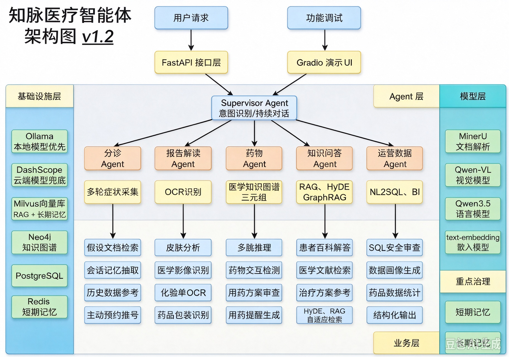

## 一、项目背景

作为三甲医院信息科负责人，我们日常面临这样的业务现状：门诊医师需要快速查阅药品说明书，检验科需要辅助解读检验报告单，药剂科要实时核查处方配伍冲突，咨询台也经常接到患者来电，询问自身症状该选择哪个科室就诊。
但当前院内数据分散隔离：药品资料存放于 HIS 系统、疾病知识散落在医学知识库、影像检验结果保存在 PACS
系统、患者就诊记录存储在电子病历中，各系统互不连通，调取信息繁琐低效。
我们希望搭建一套医疗智能体系统，打通院内多源异构数据，实现跨系统信息整合，依托 AI 能力统一承接医护、患者的各类咨询查询需求。

## 二、技术角度

从技术视角来看，医疗场景是 AI 落地价值最高、同时挑战最大的领域之一。它几乎汇集了 AI 应用落地过程中的全部典型技术难题。

| 业务痛点          |    对应技术挑战    | 
|:--------------|:------------:|
| 患者描述模糊，需多轮引导  | 多轮对话 + 短期记忆  | 
| 医学知识专业且分散     |  RAG 知识库检索   |
| 报告 / 影像需要理解图文 | 视觉语言模型（VLM）  |
| 药物关系复杂，存在多跳依赖 |  知识图谱 + 图推理  |
| 运营人员不会写 SQL   | NL2SQL Agent |
| 患者历史记录需跨会话记忆  | 长期记忆（向量数据库）  |

用医疗场景学 AI 框架，每一个技术点都有真实的业务动机，不是为了用技术而用技术。

## 三、核心用户角色

项目包含三类用户进行使用：

1. 患者 / 普通用户：症状自查、报告解读、用药咨询、健康科普；多轮问答->长短期记忆
2. 医生 / 临床医生：辅助诊断、药物相互作用检测、影像分析、文献检索;RAG高阶->图搜索
3. 医院管理 / 运营：数据查询、运营统计、患者画像、系统监控；SQL->NL2SQL

## 四、架构图

## 五、技术栈

| 模块       | 技术组件                 | 关键依赖                                     | 说明                                         |
|----------|----------------------|------------------------------------------|--------------------------------------------|
| API 应用入口 | FastAPI + Starlette  | fastapi、starlette、uvicorn                | 应用生命周期、CORS、健康检查接口                         |
| 配置中心     | Pydantic Settings    | pydantic、pydantic-settings、python-dotenv | .env 驱动配置，集中管理 DB/Redis/MinIO/Milvus/Neo4j |
| ORM 与仓储  | SQLAlchemy Async ORM | SQLAlchemy、asyncpg、greenlet              | PostgreSQL 异步引擎、会话工厂、Repository 基类         |
| 数据迁移     | Alembic              | alembic、Mako                             | 数据库版本管理与 schema 迁移                         |
| 缓存层      | Redis Async          | redis                                    | 异步连接池 + 统一客户端注入                            |
| 对象存储层    | MinIO SDK            | minio                                    | 文件上传/下载/删除与桶初始化                            |
| 向量检索层    | PyMilvus             | pymilvus、grpcio                          | Milvus 连接别名、集合访问、健康检查                      |
| 图数据库层    | Neo4j Driver         | neo4j                                    | 异步 driver 单例、连通性检查、生命周期关闭                  |
| 鉴权安全     | JWT + 密码哈希           | PyJWT、bcrypt、cryptography、Authlib        | Token 签发/校验与密码散列                           |
| 可观测性     | Loguru + Sentry      | loguru、sentry-sdk                        | 日志落盘与异常上报扩展能力                              |
| 测试层      | Pytest               | pytest、pytest-asyncio                    | 单元测试与异步测试基础设施                              |

## 六、其它

[中转站](https://www.vibeapi.cn/login)
